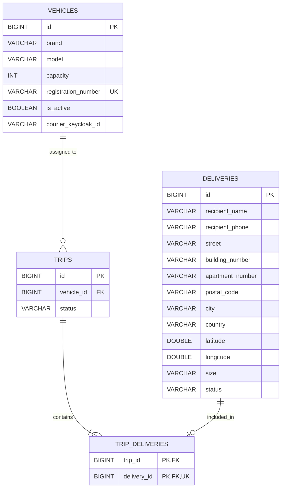

# Delivery Service

Microservice responsible for managing deliveries, vehicles and courier trips in PaczFinder.

## Run

```powershell
mvn quarkus:dev
```

## API Documentation

- Swagger UI: http://localhost:8081/q/swagger-ui/

## Endpoints

### Deliveries — `/deliveries`

| Method | Endpoint | Description |
|---|---|---|
| GET | `/deliveries` | Get all deliveries |
| GET | `/deliveries/available` | Get available deliveries |
| GET | `/deliveries/{id}` | Get delivery by ID |
| POST | `/deliveries` | Create delivery |
| PUT | `/deliveries/{id}` | Update delivery |
| DELETE | `/deliveries/{id}` | Delete delivery |

### Trips — `/trips`

| Method | Endpoint | Description |
|---|---|---|
| GET | `/trips` | Get all trips |
| POST | `/trips` | Create trip |
| GET | `/trips/{id}` | Get trip by ID |
| DELETE | `/trips/{id}` | Delete trip |
| GET | `/trips/{id}/deliveries` | Get trip deliveries |
| POST | `/trips/{id}/deliveries` | Add one delivery to trip |
| POST | `/trips/{id}/deliveries/batch` | Add multiple deliveries to trip |
| POST | `/trips/{id}/finish` | Finish trip |
| PATCH | `/trips/{id}/vehicle` | Change trip vehicle |

### Vehicles — `/vehicles`

| Method | Endpoint | Description |
|---|---|---|
| GET | `/vehicles` | Get all vehicles |
| POST | `/vehicles` | Create vehicle (optional `courierKeycloakId`) |
| GET | `/vehicles/{id}` | Get vehicle by ID |
| PUT | `/vehicles/{id}` | Update vehicle |
| DELETE | `/vehicles/{id}` | Delete vehicle |
| PATCH | `/vehicles/{id}/activate` | Activate vehicle |
| DELETE | `/vehicles/{id}/deactivate` | Deactivate vehicle |
| PATCH | `/vehicles/{id}/courier` | Assign courier to vehicle |
| DELETE | `/vehicles/{id}/courier` | Unassign courier from vehicle |

## Database Schema



## Tables

### `deliveries`
| Column | Type | Constraints | Description |
|---|---|---|---|
| `id` | BIGINT | PK, GENERATED BY DEFAULT AS IDENTITY | Identyfikator przesyłki |
| `recipient_name` | VARCHAR(100) | NOT NULL | Imię i nazwisko odbiorcy |
| `recipient_phone` | VARCHAR(20) | NOT NULL | Telefon odbiorcy |
| `street` | VARCHAR(100) | NOT NULL | Ulica |
| `building_number` | VARCHAR(10) | NOT NULL | Numer budynku |
| `apartment_number`| VARCHAR(10) | NULL | Numer mieszkania |
| `postal_code` | VARCHAR(10) | NOT NULL | Kod pocztowy |
| `city` | VARCHAR(100) | NOT NULL | Miasto |
| `country` | VARCHAR(60) | NOT NULL | Kraj |
| `latitude` | DOUBLE PRECISION | NOT NULL | Szerokość geograficzna |
| `longitude` | DOUBLE PRECISION | NOT NULL | Długość geograficzna |
| `size` | VARCHAR(1) | NOT NULL, CHECK ('S', 'M', 'L') | Rozmiar paczki |
| `status` | VARCHAR(20) | NOT NULL, DEFAULT 'ADDED', CHECK ('ADDED', 'IN_DELIVERY', 'DELIVERED') | Status dostawy |

### `vehicles`
| Column | Type | Constraints | Description |
|---|---|---|---|
| `id` | BIGINT | PK, GENERATED BY DEFAULT AS IDENTITY | Identyfikator pojazdu |
| `brand` | VARCHAR(50) | NOT NULL | Marka |
| `model` | VARCHAR(50) | NOT NULL | Model |
| `capacity` | INT | NOT NULL, CHECK (> 0) | Pojemność ładunkowa |
| `registration_number` | VARCHAR(10) | NOT NULL, UNIQUE | Numer rejestracyjny |
| `is_active` | BOOLEAN | NOT NULL, DEFAULT TRUE | Status aktywności |
| `courier_keycloak_id` | VARCHAR(255) | NULL | ID kuriera z Keycloak |

### `trips`
| Column | Type | Constraints | Description |
|---|---|---|---|
| `id` | BIGINT | PK, GENERATED BY DEFAULT AS IDENTITY | Identyfikator kursu |
| `vehicle_id` | BIGINT | NOT NULL, FK -> `vehicles(id)` | Przypisany pojazd |
| `status` | VARCHAR(20) | NOT NULL, DEFAULT 'ADDED', CHECK ('ADDED', 'FINISHED') | Status kursu |

### `trip_deliveries`
| Column | Type | Constraints | Description |
|---|---|---|---|
| `trip_id` | BIGINT | NOT NULL, PK, FK -> `trips(id)` | Kurs |
| `delivery_id` | BIGINT | NOT NULL, PK, UNIQUE, FK -> `deliveries(id)` | Przesyłka (1 przesyłka do max 1 kursu) |
