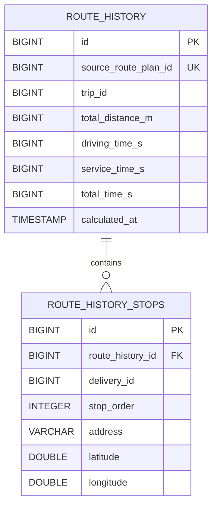

# History Service

Microservice do przechowywania snapshotów historii tras wygenerowanych przez planner.

## Run

```powershell
mvn quarkus:dev
```

Lokalnie:
- aplikacja działa na porcie `8083`
- PostgreSQL działa na porcie `5436`

## Tests

```powershell
mvnw test
```

## API Documentation

- Swagger UI: http://localhost:8083/q/swagger-ui/

## Endpoints

### Route history — `/history/routes`

| Method | Endpoint | Description |
|---|---|---|
| GET | `/history/routes?page=0&size=20` | Pobiera historię tras z paginacją |
| GET | `/history/routes/{id}` | Pobiera wpis historii po ID |
| GET | `/history/routes/source-route-plan/{sourceRoutePlanId}` | Pobiera wpis po ID planu źródłowego |
| POST | `/history/routes` | Zapisuje nowe obliczenie trasy |
| DELETE | `/history/routes/{id}` | Usuwa wpis historii |

### History by trip — `/history/trips`

| Method | Endpoint | Description |
|---|---|---|
| GET | `/history/trips/{tripId}` | Pobiera wszystkie zapisy historii dla kursu |
| GET | `/history/trips/{tripId}/latest` | Pobiera najnowszy zapis historii dla kursu |

## Database Schema



## Tables

### `route_history`

| Column | Type | Constraints | Description |
|---|---|---|---|
| `id` | BIGINT | PK, GENERATED BY DEFAULT AS IDENTITY | Identyfikator wpisu historii |
| `source_route_plan_id` | BIGINT | NOT NULL, UNIQUE | ID planu z outboxa / źródła, używany do idempotencji |
| `trip_id` | BIGINT | NOT NULL | ID kursu |
| `total_distance_m` | BIGINT | NOT NULL | Całkowita długość trasy |
| `driving_time_s` | BIGINT | NOT NULL | Czas jazdy |
| `service_time_s` | BIGINT | NOT NULL | Czas obsługi |
| `total_time_s` | BIGINT | NOT NULL | Całkowity czas trasy |
| `calculated_at` | TIMESTAMP WITH TIME ZONE | NOT NULL | Czas wygenerowania snapshotu |

### `route_history_stops`

| Column | Type | Constraints | Description |
|---|---|---|---|
| `id` | BIGINT | PK, GENERATED BY DEFAULT AS IDENTITY | Identyfikator punktu trasy |
| `route_history_id` | BIGINT | NOT NULL, FK -> `route_history(id)` | Wpis historii, do którego należy punkt |
| `delivery_id` | BIGINT | NOT NULL | ID dostawy |
| `stop_order` | INTEGER | NOT NULL | Kolejność punktu w trasie |
| `address` | VARCHAR(255) | NOT NULL | Snapshot adresu |
| `latitude` | DOUBLE PRECISION | NULL | Snapshot szerokości geograficznej |
| `longitude` | DOUBLE PRECISION | NULL | Snapshot długości geograficznej |
